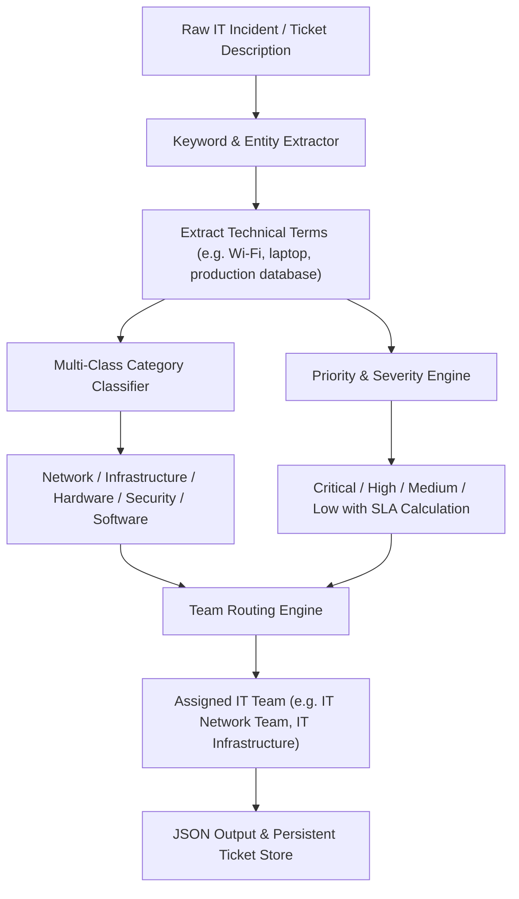

# AI IT Helpdesk Incident & Ticket Analyzer

[](https://github.com/varshith1708/HOSTEL-AI/actions/workflows/ci.yml)
[](https://www.python.org/)
[](LICENSE)
[](https://flask.palletsprojects.com/)
[](tests/)

An enterprise-grade, high-throughput AI IT Helpdesk Incident and Ticket Analyzer that automates incoming incident triage, multi-class categorization, severity prioritization, technical term extraction, and routing to specialized IT teams.

---

## Benchmark Examples

### Example 1: Office Wi-Fi Connectivity Issue
```text
Input: "My laptop is not connecting to the office Wi-Fi"
---------------------------------------------------------
Category:         Network Issue
Priority:         Medium (SLA: 8.0h)
Assigned Team:    IT Network Team
Confidence:       ~94% (0.94)
Detected Terms:   ["Wi-Fi", "connecting", "laptop"]
Response Time:    ~2.5 ms
```

### Example 2: Critical Production Database Outage
```text
Input: "production database is down"
---------------------------------------------------------
Category:         Infrastructure Issue
Priority:         Critical (SLA: 0.25h / 15 minutes)
Assigned Team:    IT Infrastructure
Confidence:       ~98% (0.98)
Detected Terms:   ["production database", "down"]
Response Time:    ~2.4 ms
```

---

## Repository Structure

```text
HOSTEL-AI/
├── .github/
│   └── workflows/
│       └── ci.yml               # GitHub Actions CI workflow (linting, tests)
├── app/
│   ├── models/
│   │   ├── __init__.py          # Exported SQLAlchemy models
│   │   └── ticket.py            # Ticket and AnalysisLog entities
│   ├── routes/
│   │   ├── __init__.py          # Blueprint registrations
│   │   ├── api.py               # REST API endpoints (v1)
│   │   └── main.py              # Web and live interactive tester views
│   ├── services/
│   │   ├── __init__.py          # Service exports
│   │   ├── analyzer_service.py  # Master incident analysis pipeline
│   │   ├── classification_service.py # Category classification & scoring
│   │   ├── keyword_service.py   # Technical term and token extraction
│   │   ├── priority_service.py  # Severity rules & SLA determination
│   │   └── routing_service.py   # IT specialist team routing
│   ├── static/
│   │   ├── css/
│   │   │   └── style.css        # Clean UI styling
│   │   └── js/
│   │       └── main.js          # Asynchronous frontend interactions
│   ├── templates/
│   │   ├── base.html            # Core layout template
│   │   ├── dashboard.html       # Ticket queue & analytics dashboard
│   │   └── index.html           # Live interactive analyzer interface
│   ├── utils/
│   │   ├── __init__.py
│   │   ├── extensions.py        # SQLAlchemy & Flask-Migrate extensions
│   │   ├── preprocessor.py      # Regex normalization & tokenization
│   │   └── taxonomy.py          # Category definitions, SLAs & rules
│   └── __init__.py              # Application factory (create_app)
├── migrations/
│   ├── versions/
│   │   └── .gitkeep
│   ├── alembic.ini
│   ├── env.py
│   └── script.py.mako
├── scripts/
│   ├── cli.py                   # Terminal CLI tool for incident triage
│   └── seed.py                  # Database seeder with sample incidents
├── tests/
│   ├── __init__.py
│   ├── conftest.py              # Pytest fixtures and test database setup
│   ├── test_analyzer.py         # Tests for core benchmark examples
│   ├── test_routes.py           # Tests for API endpoints and web views
│   └── test_services.py         # Unit tests for NLP services
├── .env.example                 # Example environment variables
├── .gitignore                   # Ignored files (virtualenvs, databases, logs)
├── LICENSE                      # MIT Open Source License
├── Procfile                     # Gunicorn web entrypoint for PaaS
├── pyproject.toml               # Python project configuration & Ruff/pytest settings
├── README.md                    # Project documentation
├── render.yaml                  # Render.com infrastructure blueprint
├── requirements.txt             # Production dependencies
├── run.py                       # Root application entrypoint
└── runtime.txt                  # Python runtime specification (3.11.9)
```

---

## Architectural Workflow



---

## Incident Taxonomy & SLAs

| Category | Keywords / Triggers | Target Team | Default Priority | Target SLA |
|---|---|---|---|---|
| **Network Issue** | `wi-fi`, `wifi`, `vpn`, `ethernet`, `connecting`, `router`, `dns`, `gateway` | IT Network Team | Medium | 8 Hours |
| **Infrastructure Issue** | `production database`, `server down`, `kubernetes`, `aws`, `outage`, `redis` | IT Infrastructure | Critical / High | 15 Mins / 2 Hours |
| **Hardware Issue** | `laptop`, `monitor`, `keyboard`, `charger`, `docking station`, `battery` | Hardware Support | Medium / Low | 8 / 24 Hours |
| **Security Incident** | `phishing`, `malware`, `ransomware`, `breach`, `credential leak` | Security Operations Center (SOC) | Critical | 15 Mins |
| **Access & Identity** | `password reset`, `account locked`, `okta`, `sso`, `active directory` | Identity & Access Management (IAM) | Medium | 8 Hours |
| **Software & Applications**| `crash`, `slack`, `teams`, `outlook`, `excel`, `bug`, `installation` | Application Support | Medium | 8 Hours |

---

## Quickstart Guide

### 1. Clone & Set Up
```bash
git clone https://github.com/varshith1708/HOSTEL-AI.git
cd HOSTEL-AI
python -m venv venv
# On Windows:
venv\Scripts\activate
# On Linux/macOS:
source venv/bin/activate
```

### 2. Install Dependencies
```bash
pip install -r requirements.txt
```

### 3. Seed Database
```bash
python -m scripts.seed
```

### 4. Run the Application
```bash
python run.py
```
Visit `http://localhost:5000` to interact with the web interface.

---

## CLI Usage

Analyze any ticket directly from your terminal:

```bash
# Wi-Fi connectivity issue
python -m scripts.cli "My laptop is not connecting to the office Wi-Fi"

# Production outage issue
python -m scripts.cli "production database is down"
```

---

## REST API Reference

### 1. Analyze Incident
**Endpoint:** `POST /api/v1/analyze`

**Request Body:**
```json
{
  "text": "My laptop is not connecting to the office Wi-Fi"
}
```

**Response:**
```json
{
  "category": "Network Issue",
  "priority": "Medium",
  "assigned_team": "IT Network Team",
  "confidence": 0.94,
  "confidence_pct": "~94%",
  "detected_terms": ["connecting", "laptop", "Wi-Fi"],
  "sla_hours": 8.0,
  "response_time_ms": 2.45
}
```

### 2. Create Ticket
**Endpoint:** `POST /api/v1/tickets`

**Request Body:**
```json
{
  "title": "Laptop wireless connection issue",
  "description": "My laptop is not connecting to the office Wi-Fi"
}
```

### 3. List Tickets
**Endpoint:** `GET /api/v1/tickets?priority=Critical`

### 4. System Health
**Endpoint:** `GET /api/v1/health`

---

## Testing

Run the test suite with `pytest`:

```bash
pytest -v
```

All 13 test cases validate the core benchmark scenarios, rule engine, edge-case token handling, and REST endpoints.

---

## Deployment (Render / Heroku)

This repository includes turnkey configuration for cloud deployment:
- **`Procfile`**: `web: gunicorn run:app`
- **`render.yaml`**: Standardized service manifest with build and seed execution
- **`runtime.txt`**: Specifies `python-3.11.9`
